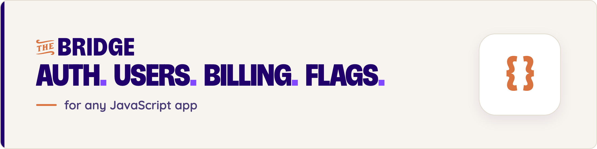

<p align="center">
  <a href="https://thebridge.dev/?utm_source=readme&utm_medium=readme&utm_campaign=bridge-auth-core"><picture><source media="(prefers-color-scheme: dark)" srcset="https://raw.githubusercontent.com/thebridgedev/auth-core/main/.github/assets/banner.png"></picture></a>
</p>

<p align="center">
  <a href="https://www.npmjs.com/package/@nebulr-group/bridge-auth-core"></a>
  <a href="https://github.com/thebridgedev/auth-core/blob/main/LICENSE"></a>
</p>

<p align="center">
  <a href="https://thebridge.dev/?utm_source=readme&utm_medium=readme&utm_campaign=bridge-auth-core"><b>Website</b></a> ·
  <a href="https://thebridge.dev/docs/getting-started/?utm_source=readme&utm_medium=readme&utm_campaign=bridge-auth-core"><b>Getting started</b></a> ·
  <a href="https://thebridge.dev/docs/?utm_source=readme&utm_medium=readme&utm_campaign=bridge-auth-core"><b>Docs</b></a> ·
  <a href="https://thebridge.dev/docs/ai-assistants/mcp/?utm_source=readme&utm_medium=readme&utm_campaign=bridge-auth-core"><b>Set up with your AI assistant</b></a>
</p>

# The Bridge auth core

`@nebulr-group/bridge-auth-core` is the framework-agnostic client behind every Bridge SDK: sign-in flows, sessions and token refresh, feature flags, billing state and the management API. Use it directly in any JavaScript app, or reach for the framework package that wraps it.

**[The Bridge](https://thebridge.dev/?utm_source=readme&utm_medium=readme&utm_campaign=bridge-auth-core)** is a hosted backend for SaaS apps. It gives you sign-in (passwords, magic links, passkeys, social login and SSO), multi-tenant workspaces with roles, Stripe subscriptions with plan limits, and feature flags, all managed from one dashboard. Your AI coding assistant can set it up for you through the [Bridge MCP server](https://thebridge.dev/docs/ai-assistants/mcp/?utm_source=readme&utm_medium=readme&utm_campaign=bridge-auth-core).

> **Let your AI assistant set it up.** Connect the [Bridge MCP server](https://thebridge.dev/docs/ai-assistants/mcp/?utm_source=readme&utm_medium=readme&utm_campaign=bridge-auth-core) to Claude, Cursor, Copilot or Gemini CLI and ask it to add Bridge to your app. Not using MCP? Run `npx @nebulr-group/bridge-cli guide add-login` in your project: it detects your framework from `package.json` and prints the steps for your assistant to follow. `npx @nebulr-group/bridge-cli doctor` checks the result.

## Install

```bash
npm install @nebulr-group/bridge-auth-core
```

## Sign users in

```ts
import { BridgeAuth } from '@nebulr-group/bridge-auth-core';

const bridge = new BridgeAuth({
  appId: 'your-app-id',
  callbackUrl: 'https://your-app.com/auth/oauth-callback',
});

// A "Sign in" button sends the user to the hosted sign-in page
signInButton.addEventListener('click', () => bridge.login());

// On your callback route, exchange the code for tokens
const code = new URLSearchParams(location.search).get('code');
if (code) await bridge.handleCallback(code);

bridge.getCurrentUser();                     // the signed-in user, or null
await bridge.isFeatureEnabled('new-editor'); // feature flags
```

`BridgeAuth` also covers in-app sign-in: passwords, magic links, passkeys, SSO, MFA, signup and workspace switching. Tokens are stored in `localStorage` in the browser and in memory on the server; pass `storage` to use your own.

## Manage your app from code

`BridgeManagement` uses an API key, so it belongs on your server, in CI or in a script, never in a browser.

```ts
import { BridgeManagement } from '@nebulr-group/bridge-auth-core';

const mgmt = new BridgeManagement({ apiKey: process.env.BRIDGE_API_KEY });
const tenants = await mgmt.tenants.list();
const flags = await mgmt.flags.list();
```

## Check who is calling your API

`createCredentialVerifier` checks the access token or API key on a request and tells you who is calling: which person, key or job, for which app, in which workspace, with which privileges. It runs on Node, in edge runtimes such as Next.js middleware, and in the browser.

```ts
import { createCredentialVerifier } from '@nebulr-group/bridge-auth-core/verifier';

const verifier = createCredentialVerifier({
  appId: 'your-app-id',
  issuer: 'https://api.thebridge.dev/auth',
  audience: 'https://api.your-app.example', // the audience your API's access tokens are issued for
  jwksUrl: 'https://api.thebridge.dev/auth/.well-known/jwks.json',
  introspectionUrl: 'https://api.thebridge.dev/account/api-token/introspect', // to accept API keys
  revocationCheck: 'none', // a token stays valid until it expires
});

const result = await verifier.verifyRequest(request); // reads only Authorization: Bearer and x-api-key
if (!result.ok) {
  // result.refusal.reason says why: 'expired', 'wrong_audience', 'unavailable', ...
  return new Response(null, { status: result.refusal.reason === 'unavailable' ? 503 : 401 });
}
const { kind, id, workspaceId, privileges } = result.actor;
```

Who is calling always comes from the checked token or key, never from other headers or the request body. Only access tokens are accepted: a token must be typed `at+jwt` and name your `audience`, which you always set yourself; an ID token is refused even though it is signed with your app's key. A short-lived token issued in exchange for an API key gives the same `Actor` as the key itself.

`revocationCheck` is required, so no verifier skips revocation by accident. With `'none'`, a token whose access was taken away keeps working until it expires.

The `Actor` replaces `BridgeUser` and `ApiTokenClaims`, which still work but are deprecated; `actorToBridgeUser` and `actorToApiTokenClaims` in `/backend` convert while you move over.

## Using a framework?

The framework packages below wrap this core with components, route guards and decorators. Start there if your framework is listed.

## Learn more

- [Getting started](https://thebridge.dev/docs/getting-started/?utm_source=readme&utm_medium=readme&utm_campaign=bridge-auth-core)
- [Sign-in inside your app](https://thebridge.dev/docs/sdk-auth/?utm_source=readme&utm_medium=readme&utm_campaign=bridge-auth-core)
- [Feature flags](https://thebridge.dev/docs/feature-flags/?utm_source=readme&utm_medium=readme&utm_campaign=bridge-auth-core)
- [Subscriptions and plan limits](https://thebridge.dev/docs/billing/how-it-works/?utm_source=readme&utm_medium=readme&utm_campaign=bridge-auth-core)
- [API reference](https://thebridge.dev/docs/api-reference/?utm_source=readme&utm_medium=readme&utm_campaign=bridge-auth-core)

## Other Bridge packages

| Package | For |
|---|---|
| [`@nebulr-group/bridge-svelte`](https://www.npmjs.com/package/@nebulr-group/bridge-svelte) | SvelteKit |
| [`@nebulr-group/bridge-react`](https://www.npmjs.com/package/@nebulr-group/bridge-react) | React |
| [`@nebulr-group/bridge-nextjs`](https://www.npmjs.com/package/@nebulr-group/bridge-nextjs) | Next.js |
| [`@nebulr-group/bridge-angular`](https://www.npmjs.com/package/@nebulr-group/bridge-angular) | Angular |
| [`@nebulr-group/bridge-nestjs`](https://www.npmjs.com/package/@nebulr-group/bridge-nestjs) | NestJS |
| [`@nebulr-group/bridge-express`](https://www.npmjs.com/package/@nebulr-group/bridge-express) | Express |
| [`@nebulr-group/bridge-cli`](https://www.npmjs.com/package/@nebulr-group/bridge-cli) | CLI for people and AI agents |

## License

[MIT](https://github.com/thebridgedev/auth-core/blob/main/LICENSE) © Nebulr. Built by [The Bridge](https://thebridge.dev/?utm_source=readme&utm_medium=readme&utm_campaign=bridge-auth-core).
